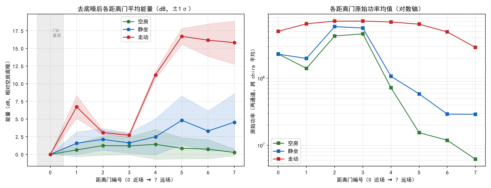

# B1 样本统计与阈值建议（离线分析）

> 本报告由 `analyze_samples.py` 自动生成，仅基于 `samples/` 现有样本；阈值建议为**参考值**，B2 接入回放/实时链路后需复核。

## 1. 样本清单

| 文件 | 场景 | 雷达帧数 | 末帧 chirp 覆盖 | 通道样本数 |
|---|---|---|---|---|
| empty_01.dat | 空房 | 470 | 41 | 60072 |
| empty_02.dat | 空房 | 396 | 7 | 50496 |
| sit_01.dat | 静坐 | 411 | 59 | 52580 |
| sit_02.dat | 静坐 | 369 | 34 | 47096 |
| walk_01.dat | 走动 | 343 | 46 | 43754 |
| walk_02.dat | 走动 | 430 | 53 | 55012 |

## 2. 解析口径说明

- MCU 帧：`ICLH` + 长度(LE) + 类型 + 通道 + 数据段 + `ICLT`；类型 0x00 为芯片数据。
- 数据段：芯片头(4B, 0xAA 开头) + 8 个复距离门（I、Q 各 int16，交织）+ 校验帧尾(4B)。
- 一个雷达帧 = 64 chirp × 2 通道；门功率 = 各 chirp/通道 `I²+Q²` 的平均值。
- `dB = 10·log10(P)`；去底噪能量 `E_g = max(0, dB_g − 空房该门平均 dB)`，空房门基准为 0。
- **门 0 按直流自杂波门剔除**（与授权软件界面“排除直流 bin0”勾选一致）：门 0 不计入超底噪能量之和、帧内方差与占用线；下表中门 0 列为 0 仅作参考。
- TODO(B2)：用授权软件界面悬停数值复核 I/Q 排列、门顺序与跨 chirp 聚合方式；拿到 `FILE_Radar_Config.ini` 核对真实门定义。

## 3. 各距离门原始功率均值

| 距离门 | 空房 | 静坐 | 走动 |
|---|---|---|---|
| 0 | 230963988 | 229007755 | 502947448 |
| 1 | 140715195 | 198122019 | 651768382 |
| 2 | 427935543 | 590133070 | 711975490 |
| 3 | 461479180 | 562378164 | 714548203 |
| 4 | 72311927 | 107223576 | 692293941 |
| 5 | 15476286 | 58564010 | 642917197 |
| 6 | 11908817 | 29218838 | 492180632 |
| 7 | 6201548 | 29055392 | 288526771 |

## 4. 各距离门去底噪能量（dB，均值 ± 标准差）

| 距离门 | 空房 | 静坐 | 走动 |
|---|---|---|---|
| 0 | 0.00 ± 0.00 | 0.00 ± 0.00 | 0.00 ± 0.00 |
| 1 | 0.62 ± 0.95 | 1.57 ± 1.60 | 6.71 ± 1.63 |
| 2 | 1.24 ± 1.36 | 2.11 ± 1.54 | 3.07 ± 0.30 |
| 3 | 1.19 ± 1.26 | 1.61 ± 1.43 | 2.70 ± 0.28 |
| 4 | 1.41 ± 2.11 | 2.48 ± 2.56 | 11.25 ± 0.55 |
| 5 | 0.85 ± 1.49 | 4.82 ± 3.46 | 16.70 ± 1.12 |
| 6 | 0.74 ± 1.35 | 3.30 ± 2.84 | 16.16 ± 2.30 |
| 7 | 0.26 ± 0.48 | 4.54 ± 4.04 | 15.81 ± 3.05 |

## 5. 帧级超底噪能量之和分布（dB·门）

| 场景 | 均值 | P50 | P90 | P95 | P99 |
|---|---|---|---|---|---|
| 空房 | 6.30 | 2.29 | 18.96 | 23.25 | 32.34 |
| 静坐 | 20.44 | 19.29 | 37.14 | 41.67 | 49.34 |
| 走动 | 72.42 | 74.24 | 79.65 | 80.27 | 81.38 |

## 6. 帧内能量向量方差分布（静坐稳定性参考）

| 场景 | 均值 | P50 | P95 |
|---|---|---|---|
| 空房 | 0.7721 | 0.1496 | 3.1421 |
| 静坐 | 6.2081 | 4.4743 | 17.8826 |
| 走动 | 41.8825 | 42.8229 | 54.5269 |

## 6b. 帧间能量差 |ΔE| 分布（走动候选特征）

> 相邻帧各距离门去底噪能量之差的绝对值之和；空房稳定→小，人走动→逐帧跳变。
| 场景 | 均值 | P50 | P90 | P95 | P99 |
|---|---|---|---|---|---|
| 空房 | 6.62 | 4.79 | 16.49 | 19.35 | 26.78 |
| 静坐 | 10.09 | 9.49 | 16.71 | 18.65 | 27.21 |
| 走动 | 4.35 | 3.92 | 7.28 | 8.62 | 11.23 |

> ⚠️ 帧间差口径下仍不可分离（空房 P99=26.78，走动 P50=3.92）。

## 7. 阈值建议（填回 config.yaml 前请人工复核）

| 配置项 | 建议值 | 依据 |
|---|---|---|
| `energy_threshold` | 区间 [32.34, 74.24]，建议 53.29 | 下界=空房 P99，上界=走动 P50 |
| `noise_floor` | 0.0 | 已在去底噪步骤扣除空房底噪 |
| `still_gate_min_energy` | 先沿用 config 占位 0.5；空房各门 P95 最大值 5.62 仅作量级参照 | 当前样本静坐近门抬升不足，占用线 B2 上机复核后再定 |
| `still_energy_variance` | ≤ 17.8826 | 静坐帧向量方差 P95；空房均值参照 0.7721 |

> 说明：以上为单帧向量方差口径；Detector 静坐窗口为 90 帧摊平方差，刻度不可直接等同，B2 回放链路接通后用真实窗口方差复核。

## 8. 各门去底噪能量对比（静坐占用线参考）

| 距离门 | 空房 P95 近似（均值+2σ） | 静坐均值 | 走动均值 |
|---|---|---|---|
| 0 | 0.00 | 0.00 | 0.00 |
| 1 | 2.53 | 1.57 | 6.71 |
| 2 | 3.95 | 2.11 | 3.07 |
| 3 | 3.71 | 1.61 | 2.70 |
| 4 | 5.62 | 2.48 | 11.25 |
| 5 | 3.82 | 4.82 | 16.70 |
| 6 | 3.43 | 3.30 | 16.16 |
| 7 | 1.21 | 4.54 | 15.81 |

## 9. 分离度诊断（B1 实测结论）

当前样本下走动与空房在平均距离能量口径上可分离；B2 回放链路复核后再定稿阈值。

## 10. 对比图

